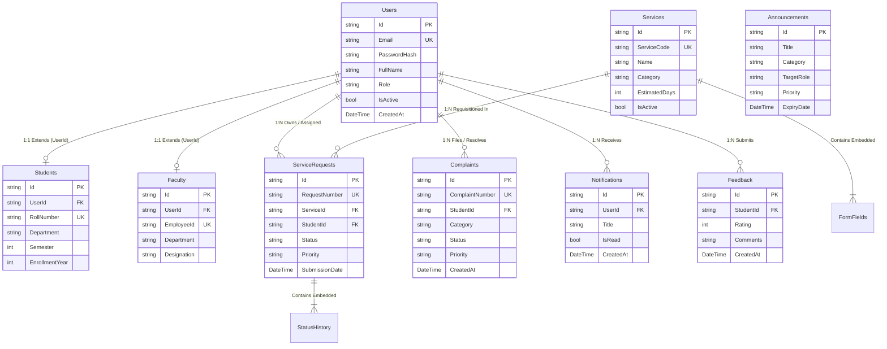

# 🗄️ Smart Campus Service Portal – Database Schema Documentation
### MongoDB Architecture, Document Structures, Indexes, and Relationships

---

## 1. Database Overview

* **Database Engine:** MongoDB Server 8.2 (x64)
* **Default Port:** `27017`
* **Target Database:** `SmartCampusDb`
* **Driver:** MongoDB C# Driver 2.25.0
* **Serialization Protocol:** BSON (Binary JSON) with typed C# entity mapping

MongoDB was selected for its high schema flexibility, document nesting capabilities (such as embedding `StatusHistory` directly inside requests), and dynamic form key-value representation (`Dictionary<string, string>`).

---

## 2. Entity-Relationship Diagram (ERD)

Although MongoDB is a document-oriented NoSQL database, the portal maintains referential relationships across collections through ObjectId and String references:



---

## 3. Detailed Collection Schemas

### 3.1 `Users` Collection
Represents all system users across all roles (`Student`, `Faculty`, `Admin`).

```json
{
  "_id": { "$oid": "673ebf129a0c4d2e8b1a2001" },
  "Email": "student.alex@campus.edu",
  "PasswordHash": "$2a$12$e6m0... (BCrypt hash)",
  "FullName": "Alex Johnson",
  "Role": "Student",
  "PhoneNumber": "+1-555-019-2834",
  "IsActive": true,
  "CreatedAt": { "$date": "2026-11-21T00:00:00.000Z" },
  "LastLoginAt": { "$date": "2026-11-21T07:10:00.000Z" }
}
```

| Field Name | BSON Type | Constraints | Description |
| :--- | :--- | :--- | :--- |
| `_id` | ObjectId | Primary Key | MongoDB Unique Document Identifier. |
| `Email` | String | Unique Index, Required | User login email address (case-insensitive). |
| `PasswordHash` | String | Required | Salted BCrypt password hash. |
| `FullName` | String | Required | Full display name of the user. |
| `Role` | String | Required | One of: `"Student"`, `"Faculty"`, `"Admin"`. |
| `PhoneNumber` | String | Optional | Contact phone number. |
| `IsActive` | Boolean | Default: `true` | Account status toggle. |
| `CreatedAt` | UTC Date | Required | Account registration timestamp. |
| `LastLoginAt` | UTC Date | Nullable | Most recent successful login timestamp. |

---

### 3.2 `Students` Collection
Stores student-specific academic profiles linked to a master `User` record.

```json
{
  "_id": { "$oid": "673ebf129a0c4d2e8b1a2010" },
  "UserId": "673ebf129a0c4d2e8b1a2001",
  "RollNumber": "CS-2024-042",
  "FullName": "Alex Johnson",
  "Department": "Computer Science",
  "Semester": 4,
  "EnrollmentYear": 2024,
  "AcademicAdvisor": "Prof. Rajesh Sharma",
  "CreatedAt": { "$date": "2026-11-21T00:00:00.000Z" }
}
```

| Field Name | BSON Type | Constraints | Description |
| :--- | :--- | :--- | :--- |
| `_id` | ObjectId | Primary Key | Unique Student Profile ID. |
| `UserId` | String | Index, Foreign Key | References `Users._id`. |
| `RollNumber` | String | Unique Index | University roll number / student matriculation ID. |
| `FullName` | String | Required | Cached full name. |
| `Department` | String | Required | Academic department (e.g. "Computer Science"). |
| `Semester` | Int32 | Required | Current active academic semester (1-8). |
| `EnrollmentYear` | Int32 | Required | Year student joined the university. |
| `AcademicAdvisor` | String | Optional | Name of assigned academic mentor. |

---

### 3.3 `Faculty` Collection
Stores faculty-specific departmental profiles linked to a master `User` record.

```json
{
  "_id": { "$oid": "673ebf129a0c4d2e8b1a2020" },
  "UserId": "673ebf129a0c4d2e8b1a2002",
  "EmployeeId": "FAC-CS-001",
  "FullName": "Prof. Rajesh Sharma",
  "Department": "Computer Science",
  "Designation": "Associate Professor & HOD",
  "OfficeLocation": "Turing Tech Block, Room 304",
  "Specialization": "Distributed Systems & Cloud Computing",
  "CreatedAt": { "$date": "2026-11-21T00:00:00.000Z" }
}
```

| Field Name | BSON Type | Constraints | Description |
| :--- | :--- | :--- | :--- |
| `_id` | ObjectId | Primary Key | Unique Faculty Document ID. |
| `UserId` | String | Index, Foreign Key | References `Users._id`. |
| `EmployeeId` | String | Unique Index | University employee payroll / faculty ID. |
| `FullName` | String | Required | Faculty title and full name. |
| `Department` | String | Required | Department of primary appointment. |
| `Designation` | String | Required | Academic designation (e.g. "Associate Professor"). |
| `OfficeLocation` | String | Optional | Physical office building and room number. |

---

### 3.4 `Services` Collection
Defines available campus services, turnaround estimates, and custom form inputs.

```json
{
  "_id": { "$oid": "673ebf129a0c4d2e8b1a2030" },
  "ServiceCode": "SRV-LIB",
  "Name": "Library Services",
  "Category": "Library",
  "Description": "Book reservations, digital library access, journal archives.",
  "Icon": "fa-book-open-reader",
  "EstimatedDays": 1,
  "Department": "University Central Library",
  "IsActive": true,
  "FormFields": [
    {
      "Name": "RequestType",
      "Label": "Service Required",
      "FieldType": "select",
      "IsRequired": true,
      "Options": ["Book Borrowing / Reservation", "Digital Repository Pass", "Inter-Library Loan"]
    },
    {
      "Name": "BookTitle",
      "Label": "Book Title / Journal Name & Author",
      "FieldType": "text",
      "IsRequired": true,
      "Placeholder": "e.g. Introduction to Algorithms (CLRS)"
    }
  ],
  "CreatedAt": { "$date": "2026-11-21T00:00:00.000Z" }
}
```

| Field Name | BSON Type | Constraints | Description |
| :--- | :--- | :--- | :--- |
| `_id` | ObjectId | Primary Key | Unique Service ID. |
| `ServiceCode` | String | Unique Index | Canonical service code (e.g. `"SRV-LIB"`, `"SRV-ITS"`). |
| `Name` | String | Required | Descriptive service title. |
| `Category` | String | Required | Service category. |
| `Description` | String | Required | Full explanation of service scope. |
| `Icon` | String | Required | Font Awesome icon class (e.g. `"fa-laptop-code"`). |
| `EstimatedDays` | Int32 | Required | Estimated business days to fulfill. |
| `Department` | String | Required | Campus department responsible for fulfillment. |
| `IsActive` | Boolean | Default: `true` | Visibility toggle for student applications. |
| `FormFields` | Array[Object] | Embedded | Dynamic input schema required for application. |

---

### 3.5 `ServiceRequests` Collection
Records every student requisition, captured form data, and chronological status history.

```json
{
  "_id": { "$oid": "673ebf129a0c4d2e8b1a2050" },
  "RequestNumber": "REQ-2026-0001",
  "ServiceId": "SRV-CRT",
  "ServiceName": "Student Certificates",
  "ServiceCategory": "Certificates",
  "StudentId": "673ebf129a0c4d2e8b1a2001",
  "StudentName": "Alex Johnson",
  "StudentEmail": "student.alex@campus.edu",
  "StudentRollNo": "CS-2024-042",
  "Department": "Computer Science",
  "Priority": "High",
  "Status": "Completed",
  "AssignedToId": "673ebf129a0c4d2e8b1a2002",
  "AssignedToName": "Prof. Rajesh Sharma",
  "AssignedRole": "Faculty",
  "FormDetails": {
    "CertificateType": "Bonafide Student Certificate",
    "Purpose": "Applying for Global Student Developer Grant",
    "DeliveryFormat": "Digital Signed PDF"
  },
  "Remarks": "Certificate signed digitally and generated successfully.",
  "SubmissionDate": { "$date": "2026-11-14T07:00:00.000Z" },
  "UpdatedAt": { "$date": "2026-11-16T07:00:00.000Z" },
  "StatusHistory": [
    {
      "Status": "Pending",
      "ChangedBy": "Alex Johnson",
      "Role": "Student",
      "Timestamp": { "$date": "2026-11-14T07:00:00.000Z" },
      "Comment": "Service request submitted."
    },
    {
      "Status": "Completed",
      "ChangedBy": "Dr. Robert Vance",
      "Role": "Admin",
      "Timestamp": { "$date": "2026-11-16T07:00:00.000Z" },
      "Comment": "Official digital seal attached. Request fulfilled."
    }
  ]
}
```

| Field Name | BSON Type | Constraints | Description |
| :--- | :--- | :--- | :--- |
| `_id` | ObjectId | Primary Key | MongoDB Unique ID. |
| `RequestNumber` | String | Unique Index | Human-readable sequence number (`REQ-2026-XXXX`). |
| `ServiceId` | String | Index, Foreign Key | ID or Code referencing `Services`. |
| `StudentId` | String | Index, Foreign Key | References `Users._id` of student applicant. |
| `Status` | String | Index | One of: `"Pending"`, `"In Progress"`, `"Approved"`, `"Rejected"`, `"Completed"`. |
| `Priority` | String | Default: `"Medium"` | `"Low"`, `"Medium"`, `"High"`, `"Urgent"`. |
| `FormDetails` | Document | Embedded Key-Value | Dynamic form field answers submitted by student. |
| `StatusHistory` | Array[Object] | Embedded | Complete audit log of all status transitions. |

---

### 3.6 `Complaints` Collection
Grievance ticketing system capturing issue reports, categories, and resolution progress.

```json
{
  "_id": { "$oid": "673ebf129a0c4d2e8b1a2060" },
  "ComplaintNumber": "CMP-2026-0001",
  "StudentId": "673ebf129a0c4d2e8b1a2001",
  "StudentName": "Alex Johnson",
  "StudentRollNo": "CS-2024-042",
  "Department": "Computer Science",
  "Category": "Hostel & Accommodation",
  "Subject": "Frequent Hot Water Supply Interruption in Block B",
  "Description": "The solar geyser system in Block B, 3rd floor showers has been malfunctioning.",
  "Location": "Boys Hostel Block B, Floor 3",
  "Priority": "High",
  "Status": "Under Investigation",
  "AssignedToId": "673ebf129a0c4d2e8b1a2002",
  "AssignedToName": "Prof. Rajesh Sharma",
  "OfficialResponse": "Estate engineer inspected the heating elements. Replacement parts ordered.",
  "CreatedAt": { "$date": "2026-11-18T00:00:00.000Z" },
  "UpdatedAt": { "$date": "2026-11-19T00:00:00.000Z" }
}
```

---

### 3.7 `Announcements` Collection
Campus-wide and role-targeted public bulletins.

```json
{
  "_id": { "$oid": "673ebf129a0c4d2e8b1a2070" },
  "Title": "Campus Tech Innovation Expo & Hackathon 2026",
  "Content": "Registrations are officially open for the Annual 48-Hour Smart Campus Hackathon.",
  "Category": "Event",
  "TargetRole": "Student",
  "Priority": "Medium",
  "AuthorName": "Innovation & Entrepreneurship Cell",
  "IsActive": true,
  "CreatedAt": { "$date": "2026-11-17T00:00:00.000Z" },
  "ExpiryDate": { "$date": "2026-12-11T00:00:00.000Z" }
}
```

---

### 3.8 `Notifications` Collection
Personalized alerts dispatched when request or complaint statuses change.

```json
{
  "_id": { "$oid": "673ebf129a0c4d2e8b1a2080" },
  "UserId": "673ebf129a0c4d2e8b1a2001",
  "Title": "Request Approved: Student Certificates",
  "Message": "Your request REQ-2026-0001 has been approved.",
  "Type": "success",
  "Link": "/Student/RequestDetails/673ebf129a0c4d2e8b1a2050",
  "IsRead": false,
  "CreatedAt": { "$date": "2026-11-20T00:00:00.000Z" }
}
```

---

### 3.9 `CampusFeedback` Collection
Service rating reviews and student improvement proposals.

```json
{
  "_id": { "$oid": "673ebf129a0c4d2e8b1a2090" },
  "StudentId": "673ebf129a0c4d2e8b1a2001",
  "StudentName": "Alex Johnson",
  "ServiceId": "SRV-ITS",
  "ServiceName": "IT Support",
  "Rating": 5,
  "Comments": "MAC address registration was approved within an hour. Excellent response time!",
  "CreatedAt": { "$date": "2026-11-19T00:00:00.000Z" }
}
```

---

## 4. Database Indexing Strategy

To maintain sub-millisecond query performance during high concurrent campus traffic, the following indexes are maintained by `MongoDbContext.CreateIndexes()`:

| Collection | Indexed Field(s) | Index Type | Purpose |
| :--- | :--- | :--- | :--- |
| **`Users`** | `Email` | Unique Index (Ascending) | Instant login lookups; enforces unique emails. |
| **`Students`** | `UserId` | Single Field Index | Rapid joins to master user records. |
| **`Students`** | `RollNumber` | Unique Index | Guarantees roll number uniqueness. |
| **`Faculty`** | `UserId` | Single Field Index | Rapid joins to master user records. |
| **`Faculty`** | `EmployeeId` | Unique Index | Guarantees faculty ID uniqueness. |
| **`Services`** | `ServiceCode` | Unique Index | Fast canonical service lookups (`SRV-LIB`). |
| **`ServiceRequests`** | `RequestNumber` | Unique Index | Fast retrieval for tracking numbers (`REQ-2026-XXXX`). |
| **`ServiceRequests`** | `StudentId` | Compound Index | Fast retrieval of student's request history. |
| **`ServiceRequests`** | `Status` | Single Field Index | Optimizes dashboard status queries and filters. |
| **`Complaints`** | `ComplaintNumber`| Unique Index | Fast retrieval for complaint tickets (`CMP-2026-XXXX`). |
| **`Complaints`** | `StudentId` | Single Field Index | Fast retrieval of student's grievance history. |
| **`Notifications`** | `UserId, IsRead` | Compound Index | High-speed retrieval of unread notifications for navbar bell. |

---
*Smart Campus Service Portal &bull; Database Schema Specification &bull; 2026*
