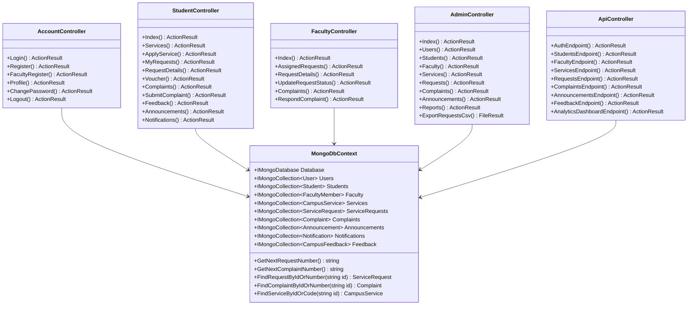

# 📘 Smart Campus Service Portal – Detailed Project Documentation
### Architectural Specification, MVC Blueprint, and Technical Implementation Manual

---

## 1. Project Introduction & Objectives

### 1.1 Context
In traditional university campuses, students and faculty often encounter significant administrative friction. Requests for certificates, hostel room maintenance, IT support, bus passes, and general campus grievances are handled through fragmented channels—physical paper forms, separate departmental emails, or manual in-person queues. This leads to lost requests, lack of transparency, delayed approvals, and an inability for campus leadership to gauge operational efficiency.

### 1.2 Core Objectives
The **Smart Campus Service Portal** was engineered as an enterprise-grade, centralized web application aimed at:
1. **Unifying Campus Workflows:** Providing a single, role-governed digital gateway for all student and faculty service requisitions.
2. **Real-Time Operational Transparency:** Giving students a visual, step-by-step timeline of where their request stands, who is currently reviewing it, and timestamps of every status transition.
3. **Accountability & Departmental Delegation:** Enabling administrators to assign requests and student grievances directly to authorized faculty members or department heads.
4. **Data-Driven Governance:** Equipping campus directors with live KPI metrics and dynamic visual analytics to identify operational bottlenecks across departments.
5. **Seamless MVC Architecture & Hybrid API:** Integrating an ASP.NET MVC 5 presentation layer with a high-performance MongoDB document database and a standard RESTful API.

---

## 2. Technology Stack & Technical Rationale

| Layer | Component | Selected Technology | Technical Rationale |
| :--- | :--- | :--- | :--- |
| **Presentation (View)** | Razor / HTML5 / CSS3 / JS | ASP.NET Razor (MVC 5), Bootstrap 5.2.3, Font Awesome 6.5.1, Chart.js | Server-side rendering ensures fast page delivery and SEO friendliness. Bootstrap 5 provides a modern responsive grid, while Chart.js renders lightweight interactive charts. |
| **Application (Controller)** | Business Logic & Routing | C# / .NET Framework 4.7.2, ASP.NET MVC 5.2.9 | Robust, strictly typed enterprise framework with integrated routing, model binding, and attribute-based security filters. |
| **Data Layer (Model)** | Object-Document Mapper | MongoDB C# Driver 2.25.0 | Official driver offering high-throughput BSON serialization, expression-tree LINQ queries, and atomic document updates. |
| **Persistence (Database)** | Enterprise Document Store | MongoDB Server 8.2 (x64) | Flexible document schema accommodates varying dynamic form schemas across diverse services (Library vs IT vs Transport) without schema lock-in. |
| **Security & Hashing** | Password Cryptography | BCrypt.Net-Next 4.0.3 | Industry standard Blowfish-based adaptive key derivation function with automatic work-factor salting. |
| **API Authentication** | Stateless Token Service | HMAC-SHA256 Token Provider | Enables secure, stateless Bearer token authorization for external clients and mobile apps alongside cookie session auth. |

---

## 3. System Architecture & MVC Breakdown

The application strictly implements the **Model-View-Controller (MVC)** architectural pattern, separating data models, presentation logic, and business controllers into cohesive, decoupled layers.



### 3.1 Model Layer (`/Models/`)
* **Entity Documents:**
  * `User.cs`: Master user account containing `Email`, `PasswordHash`, `FullName`, `Role`, `IsActive`, and audit timestamps.
  * `Student.cs`: Extended student profile with `RollNumber`, `Department`, `Semester`, and `EnrollmentYear`.
  * `FacultyMember.cs`: Extended faculty profile with `EmployeeId`, `Department`, `Designation`, and `Specialization`.
  * `CampusService.cs`: Master service definition including category, estimated turnaround days, department, and a structured list of dynamic `ServiceFormField` definitions.
  * `ServiceRequest.cs`: Transactional service application containing student details, selected service, custom form answers, current status, assignment details, and a sequential `StatusHistory` array.
  * `Complaint.cs`: Campus grievance record containing subject, category, urgency, location, resolution notes, and status.
  * `Announcement.cs`: Campus-wide announcements with priority levels and target audience scoping.
  * `Notification.cs`: Per-user alert feed records.
  * `CampusFeedback.cs`: Quantitative (1-5 stars) and qualitative student feedback.
* **Database Context (`MongoDbContext.cs`):** Thread-safe singleton providing typed collections, automated index generation, sequence counter algorithms (`REQ-2026-XXXX`), and type-safe query helpers.
* **ViewModels (`/Models/ViewModels/`):** Strongly typed models encapsulating view validation rules (e.g., `LoginViewModel`, `ServiceRequestDetailViewModel`, `AdminDashboardViewModel`).

### 3.2 View Layer (`/Views/`)
* **Unified SaaS Shell (`_Layout.cshtml`):** Responsive sidebar layout with real-time active route indicators, user profile pill, and notification badges.
* **Public Portal:** Clean modern landing page (`Home/Index.cshtml`) showing live campus stats, featured services, and announcements.
* **Dynamic Form Rendering:** `Student/ApplyService.cshtml` inspects the service's `FormFields` list and dynamically renders textboxes, select dropdowns, and textareas with client and server-side validation.
* **Audit Timeline Component:** Visual multi-stage status tracker with color-coded nodes indicating past and current processing phases.
* **Printable Acknowledgment Voucher (`Student/Voucher.cshtml`):** Formal CSS-styled voucher designed for A4 printing and PDF export, complete with digital verification hash, student credentials, and signature blocks.
* **Chart.js Dashboard:** `Admin/Index.cshtml` leverages HTML5 Canvas with custom themes to visualize request progression and service utilization.

### 3.3 Controller Layer (`/Controllers/`)
* **`AccountController`:** Handles user registration, BCrypt password validation, session initialization, profile editing, and password updates.
* **`StudentController`:** Encapsulates all student actions behind `[AuthorizeRole("Student")]`.
* **`FacultyController`:** Manages assigned request verification, status updates, and complaint resolutions behind `[AuthorizeRole("Faculty")]`.
* **`AdminController`:** Comprehensive administrative management suite behind `[AuthorizeRole("Admin")]`.
* **`ApiController`:** Standardized RESTful endpoints supporting both Bearer token and Session authentication, outputting uniform JSON responses with proper HTTP status codes.

---

## 4. Role Capabilities & Access Control Matrix

The platform enforces strict role-based access control (RBAC) via the custom `[AuthorizeRole]` action filter:

| Capability / Resource | Public / Guest | Student | Faculty | Administrator |
| :--- | :---: | :---: | :---: | :---: |
| View Public Campus Landing & Services Directory | ✅ | ✅ | ✅ | ✅ |
| Register Student Account | ✅ | ❌ | ❌ | ❌ |
| Register Faculty Account (Admin Reg / Secret Code) | ✅ | ❌ | ❌ | ✅ |
| Submit New Service Request | ❌ | ✅ | ❌ | ❌ |
| Track Request Progression & History | ❌ | ✅ (Own) | ✅ (Assigned) | ✅ (All) |
| Generate Printable Service Voucher Slip | ❌ | ✅ (Own) | ✅ (Assigned) | ✅ (All) |
| File Grievance / Complaint | ❌ | ✅ | ❌ | ❌ |
| Update Request Status (`Approved`/`Rejected`/`Completed`) | ❌ | ❌ | ✅ (Assigned) | ✅ (Any) |
| Assign Requests to Faculty | ❌ | ❌ | ❌ | ✅ |
| Investigate & Resolve Student Complaints | ❌ | ❌ | ✅ (Assigned) | ✅ (All) |
| Manage Campus Services (Add/Edit/Disable) | ❌ | ❌ | ❌ | ✅ |
| Manage User Accounts (Deactivate/Activate) | ❌ | ❌ | ❌ | ✅ |
| Broadcast Announcements | ❌ | ❌ | ❌ | ✅ |
| View Executive Analytics & Export CSV Reports | ❌ | ❌ | ❌ | ✅ |

---

## 5. Campus Services & Workflow Engine

### 5.1 Pre-Configured Campus Services
1. **Library Services:** Book reservations, digital repository access, thesis archival.
2. **Hostel Services:** Room allotment, maintenance complaints, gate pass requests.
3. **Transport Services:** Semester bus passes, route amendments, campus parking permits.
4. **IT Support:** Wi-Fi MAC registration, institutional portal/email resets, lab software licenses.
5. **Maintenance Requests:** Electrical, plumbing, carpentry, air conditioning work orders.
6. **Student Certificates:** Bonafide certificates, official transcripts, NOCs, fee structure slips.
7. **Event Registration:** Technical symposiums, annual hackathons, cultural festivals, sports meets.
8. **Classroom & Laboratory Support:** Projector/AV support, lab equipment requisitions, consumable requests.

### 5.2 Dynamic Form Engine
Each campus service defines a dynamic JSON schema stored directly in MongoDB:
```json
{
  "name": "RouteNumber",
  "label": "Bus Route / Pickup Stop",
  "fieldType": "text",
  "isRequired": true,
  "placeholder": "e.g. Route 7 - Metro Station to Campus"
}
```
When a student selects a service, `StudentController.ApplyService` renders these fields on the fly. Upon submission, the values are captured in a structured `Dictionary<string, string>` and saved within the `ServiceRequest` document.

### 5.3 Request Lifecycle & Status Transitions
Every service request transitions through a defined state machine:
```
  [Pending] ───────────────► [Rejected] (with reviewer reason)
      │
      ▼
[In Progress] (under review by assigned faculty)
      │
      ▼
 [Approved] ──► [Completed] (fulfilled with official remarks)
```
Each transition creates an entry in `StatusHistory` recording:
* New status
* Reviewer name and role
* Timestamp (UTC)
* Administrative remarks/justification

---

## 6. Complaint Management Subsystem

The complaint module provides students with a transparent channel to voice grievances regarding academics, infrastructure, hygiene, transport, or administration.

### Key Features:
* **Unique Tracking Number:** Complaints automatically receive an incrementing identifier (`CMP-2026-0001`).
* **Categorization & Urgency:** Categorized into Infrastructure, Academic, Hostel, Transport, IT, or Administrative, with urgency markers (`Routine`, `Priority`, `Emergency`).
* **Resolution Workflow:** Authorized faculty or administrators can review the complaint details, assign investigating officers, post official responses, and transition status from `Open` to `Under Investigation` or `Resolved`.

---

## 7. Security Architecture

1. **Password Hashing:** Passwords are never stored in plaintext. Passwords use BCrypt with automatically computed 12-round salt strings.
2. **Role-Based Authorization:** Custom `AuthorizeRoleAttribute` intercepts every controller action:
   * Web requests: Redirects unauthenticated users to `/Account/Login?returnUrl=...` and unauthorized users to an Access Denied view.
   * API requests: Returns HTTP 401 Unauthorized or HTTP 403 Forbidden with uniform JSON error payloads.
3. **Anti-CSRF Tokens:** All state-changing web forms include `@Html.AntiForgeryToken()`, validated on submission with `[ValidateAntiForgeryToken]`.
4. **API Token Authentication:** Dual-mode authentication supports standard Cookie sessions for browser users and stateless `Bearer <token>` (HMAC-SHA256) headers for API consumers.
5. **Input Validation & Sanitization:** Models enforce strict validation rules (`[Required]`, `[EmailAddress]`, `[MinLength]`), and Razor automatically encodes output to mitigate Cross-Site Scripting (XSS).

---

## 8. Quality Assurance & Verification

The application was validated using an automated PowerShell test suite (`test_suite.ps1`) covering 32 integration scenarios against a live IIS Express server and MongoDB database:

```
==========================================================
 SMART CAMPUS SERVICE PORTAL - TEST VERIFICATION SUMMARY
==========================================================
1. Public Web Pages              : 7 / 7  [100% PASS]
2. REST API Endpoints            : 11 / 11 [100% PASS]
3. Role Authorization Boundaries : 2 / 2  [100% PASS]
4. Authenticated Dashboards      : 12 / 12 [100% PASS]
----------------------------------------------------------
TOTAL TESTS EXECUTED             : 32 / 32 [100% PASS]
RUNTIME STABILITY                : Zero unhandled exceptions
==========================================================
```

---
*Smart Campus Service Portal &bull; Enterprise Architectural Documentation &bull; 2026*
