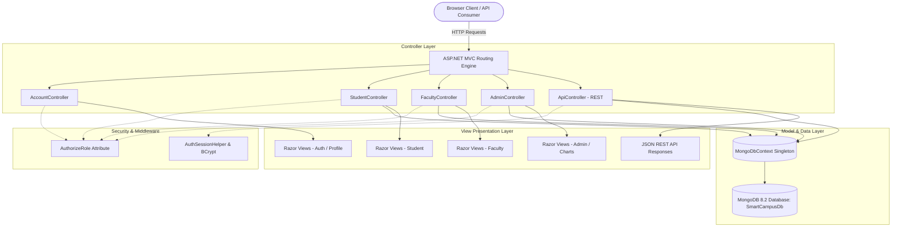

# 🎓 Smart Campus Service Portal – Feature Extension
### Enterprise Full-Stack Campus Service Management Solution
**Architecture:** Model-View-Controller (MVC) &bull; **Database:** MongoDB 8.2 (NoSQL) &bull; **API:** RESTful Service Endpoints &bull; **UI/UX:** Modern Responsive SaaS Dashboard

---

## 📌 Executive Summary

The **Smart Campus Service Portal** is a centralized, role-based enterprise web application designed to digitize, streamline, and govern all administrative, academic, and facility operations across a university campus. 

Bridging the divide between students, academic departments, and central campus administration, this portal replaces disjointed paper forms, ad-hoc emails, and manual queues with automated workflows, real-time ticket progression tracking, complaint resolution, and data-driven administrative dashboards.

---

## 🚀 Key Feature Highlights

### 1. 👨‍🎓 Student Hub
* **Personal Profile & Academic Details:** Real-time visibility into enrollment, department, semester, and contact credentials.
* **8 Core Campus Services:** Dynamic form submission with validation and instant tracking ID generation (`REQ-2026-XXXX`).
* **Interactive Timeline Tracking:** Step-by-step visual audit trail displaying every status transition (`Pending` &rarr; `In Progress` &rarr; `Approved` &rarr; `Completed` / `Rejected`) with reviewer comments.
* **Printable Acknowledgment Voucher:** Official printable/PDF voucher slip with unique security hash for offline campus verification.
* **Grievance / Complaint Desk:** Categorized complaint ticket submission (`CMP-2026-XXXX`) with live resolution tracking.
* **Campus Feedback & Ratings:** 5-star rating and suggestion submission system to foster continuous campus facility improvements.
* **Announcement Center & Notification Bell:** Instant notification feed alerting students whenever their requests or complaints receive updates.

### 2. 👨‍🏫 Faculty Workspace
* **Assigned Requests Queue:** Dedicated view of academic and departmental service applications assigned for verification.
* **One-Click Request Adjudication:** Ability to approve, reject, or mark requests as in-progress with formal administrative remarks.
* **Student Complaints Review:** Department-level investigation tools with official resolution dispatch.
* **Department Services Catalog:** Real-time view of services belonging to the faculty member's department.
* **Student Feedback Feed:** Review submitted satisfaction scores and student feedback.

### 3. 🛡️ Administrator Operations Center
* **Executive KPI Dashboard:** Real-time metrics counting registered students, faculty, open complaints, and pending vs. completed requests.
* **Interactive Chart.js Visualizations:**
  * Request Status Distribution (Doughnut Chart)
  * Service Category Breakdown (Bar Chart)
  * Daily Submission Activity Trend (Area Line Chart)
  * Complaint Category Distribution (Polar Area Chart)
* **Comprehensive User Management:** Complete directory of Student and Faculty accounts with instant account activation/suspension toggles.
* **Services Management (Full CRUD):** Add new services, edit parameters, configure custom dynamic form fields, and toggle service availability.
* **Campus-Wide Oversight:** Reassign service requests or complaints to any faculty member or resolve issues centrally.
* **Campus Announcement Broadcaster:** Publish targeted announcements (`All`, `Student`, `Faculty`) with priority alerts (`Urgent`, `High`, `Normal`).
* **Reporting & Data Export:** One-click CSV export (`/Admin/ExportRequestsCsv`) for audit readiness and institutional reporting.

---

## 🏛️ The 8 Mandatory Campus Services

The portal comes pre-seeded and dynamically configured with 8 full-featured campus service workflows:

1. 📚 **Library Services:** Book reservation, research paper access, digital repository membership, and renewal requests.
2. 🏢 **Hostel Services:** Room allotment, maintenance complaints, room change requests, and visitor gate pass issuance.
3. 🚌 **Transport Services:** Semester bus passes, route alterations, parking permits, and campus shuttle access.
4. 💻 **IT Support:** High-speed campus Wi-Fi MAC registration, institutional email password reset, and lab software licenses.
5. 🛠️ **Maintenance Requests:** Civil, electrical, plumbing, HVAC/air conditioning, and carpentry work orders.
6. 📜 **Student Certificates:** Bonafide certificates, official transcripts, course completion certificates, and No-Objection Certificates (NOC).
7. 🎪 **Event Registration:** Campus tech symposiums, hackathons, sports tournaments, and club activities.
8. 🔬 **Classroom & Laboratory Support:** Projector/smartboard maintenance, specialized lab equipment booking, and consumable requisitions.

---

## 🏗️ System Architecture

The application is structured following the classic, enterprise-grade **Model-View-Controller (MVC)** architectural design pattern:



---

## 💻 Technology Stack

| Layer | Technology | Version | Purpose |
| :--- | :--- | :--- | :--- |
| **Backend Framework** | ASP.NET MVC | 5.2.9 | Core Web Framework (.NET Framework 4.7.2) |
| **Database** | MongoDB Server | 8.2 (x64) | Enterprise NoSQL Document Store |
| **Database Driver** | MongoDB.Driver | 2.25.0 | Official C# Asynchronous / Synchronous Driver |
| **Cryptography** | BCrypt.Net-Next | 4.0.3 | Industry-standard salted password hashing |
| **Token Auth** | HMAC-SHA256 | Custom | Stateless Bearer API authorization |
| **Styling & UI** | Bootstrap & Custom CSS | 5.2.3 | Modern SaaS styling, CSS Grid, Flexbox, responsive navbar |
| **Icons** | Font Awesome | 6.5.1 | Comprehensive UI symbology |
| **Data Analytics** | Chart.js | 4.4.1 | Dynamic interactive HTML5 Canvas charts |
| **Server Engine** | IIS Express / IIS | 10.0+ | Fast web server hosting environment |

---

## 🔑 Default Demo Accounts

The portal seeds these demonstration accounts on initial startup:

| Role | Email Address | Password | Permissions & Functions |
| :--- | :--- | :--- | :--- |
| 🛡️ **Administrator** | `admin@campus.edu` | `Admin@123` | Full system control, analytics, user & service CRUD, reports. |
| 👨‍🏫 **Faculty Member** | `faculty.sharma@campus.edu` | `Faculty@123` | Department requests, complaint resolution, student feedback. |
| 👨‍🏫 **Faculty Member** | `faculty.chen@campus.edu` | `Faculty@123` | Department requests, academic service evaluation. |
| 👨‍🎓 **Student** | `student.alex@campus.edu` | `Student@123` | Service requests, tracking, complaints, feedback, vouchers. |
| 👨‍🎓 **Student** | `student.priya@campus.edu` | `Student@123` | Computer Science student account with submitted applications. |

> **Pro Tip:** The login page (`/Account/Login`) features **1-Click Quick Login** buttons to immediately populate and authenticate as any of the roles for effortless testing!

---

## ⚡ Quick Start Guide

### Prerequisites
1. **Windows 10 / 11 / Windows Server**
2. **.NET Framework 4.7.2 Developer Pack**
3. **MongoDB Server 8.2** (running locally on port `27017`)
4. **Visual Studio 2022 / Community** or **MSBuild 17+**
5. **IIS Express** (installed by default with Visual Studio)

### Build & Run Instructions
```powershell
# 1. Clone or navigate to the project root
cd "C:\Users\nandu\source\repos\Smart Campus Service Portal\Smart Campus Service Portal"

# 2. Compile the project with MSBuild
& "C:\Program Files\Microsoft Visual Studio\18\Community\MSBuild\Current\Bin\MSBuild.exe" "Smart Campus Service Portal.csproj" /p:Configuration=Debug /t:Build

# 3. Launch the application on IIS Express
& "C:\Program Files\IIS Express\iisexpress.exe" /path:"$PWD" /port:62359

# 4. Open in your browser
Start-Process "http://localhost:62359"
```

---

## 🧪 Comprehensive Automated Test Suite

The solution contains a full PowerShell test harness (`test_suite.ps1`) verifying all 32 critical subsystems:
* 7 Public pages (Home, About, Contact, Login, Registers, Forgot Password)
* 11 REST API endpoints (Auth, Students, Faculty, Services, Requests CRUD, Complaints, Feedback, Announcements, Analytics)
* 2 Role authorization perimeter tests (Verifying unauthenticated redirection to `/Account/Login`)
* 12 Authenticated session dashboards across Student, Faculty, and Admin roles

To execute the test suite:
```powershell
powershell -ExecutionPolicy Bypass -File test_suite.ps1
```
**Result:** 32 / 32 Passed (100% Success Rate).

---

## 📚 Complete Project Documentation

For deeper architectural, API, and database specifications, consult the dedicated documentation files:

* 📖 **[PROJECT_DOCUMENTATION.md](file:///c:/Users/nandu/source/repos/Smart%20Campus%20Service%20Portal/Smart%20Campus%20Service%20Portal/PROJECT_DOCUMENTATION.md)** &ndash; Comprehensive architectural blueprint, role matrices, MVC workflows, and security implementations.
* 🌐 **[API_DOCUMENTATION.md](file:///c:/Users/nandu/source/repos/Smart%20Campus%20Service%20Portal/Smart%20Campus%20Service%20Portal/API_DOCUMENTATION.md)** &ndash; Complete REST API specification with endpoint URLs, verbs, headers, request bodies, and JSON responses.
* 🗄️ **[DATABASE_SCHEMA.md](file:///c:/Users/nandu/source/repos/Smart%20Campus%20Service%20Portal/Smart%20Campus%20Service%20Portal/DATABASE_SCHEMA.md)** &ndash; MongoDB schema documentation, collection fields, indexes, and document relationships.
* 🛠️ **[INSTALLATION_GUIDE.md](file:///c:/Users/nandu/source/repos/Smart%20Campus%20Service%20Portal/Smart%20Campus%20Service%20Portal/INSTALLATION_GUIDE.md)** &ndash; Step-by-step setup guide for MongoDB, IIS Express, compilation, and troubleshooting.

---
*Developed with enterprise engineering rigor &bull; Smart Campus University 2026*
